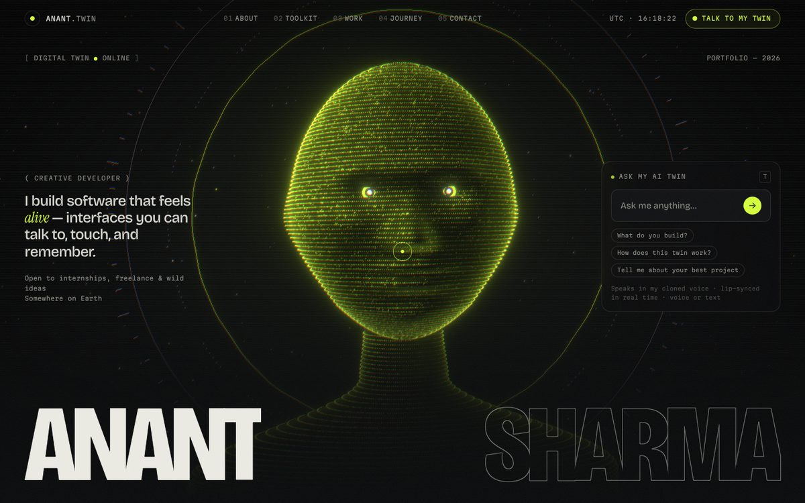
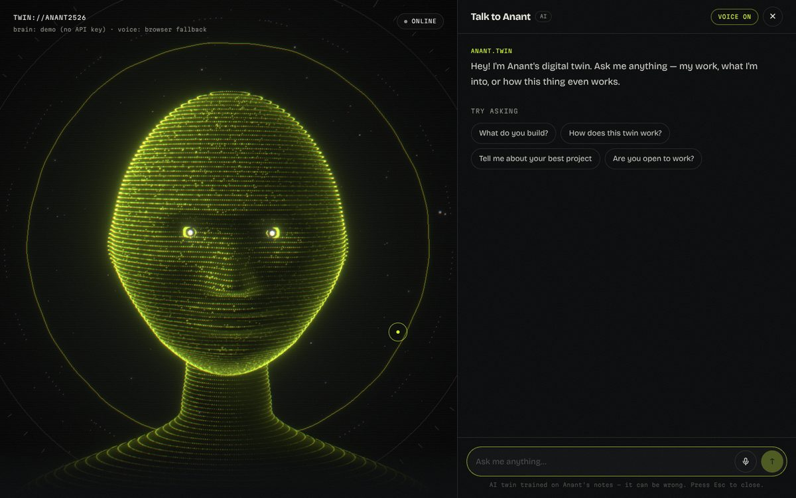

# Digital Twin Portfolio

An interactive 3D portfolio where visitors can **talk to an AI version of you**. The twin answers any question, in **your own cloned voice**, with a 3D avatar that **lip-syncs** every word in real time.




## What's inside

- **AI twin.** Claude answers questions about you, in your style, using only what you've written about yourself. It says "I don't know" instead of inventing things.
- **Your voice.** ElevenLabs voice cloning reads each answer aloud. Sentences start playing while Claude is still writing the rest.
- **Real lip-sync.** ElevenLabs returns per-character timestamps. Those become mouth shapes (visemes), blended with live audio loudness, so the mouth hits every syllable.
- **3D avatar of you.** The **Twin Studio** turns one photo of you into a 3D face mesh with your real proportions. It's textured with your photo and rigged so the jaw, lips and eyelids move. Until you scan, a procedural holographic bust stands in. A full-head `.glb` model also works.
- **Twin Studio** (`localhost:3000/studio`). Scan your face and record a few prompts to clone your voice, all from the browser.
- **Voice input.** Hold a conversation by mic (Chrome, Edge, Safari) or by text. Speaking interrupts the twin.
- **The rest of the portfolio:**
  - terminal boot sequence
  - scroll-reactive giant typography
  - word-by-word bio reveal
  - draggable 3D skill sphere
  - pinned horizontal project gallery with tilt cards and generative covers
  - scroll-drawn timeline
  - magnetic buttons and a custom cursor
  - Lenis smooth scrolling, film grain and scanlines
- **Works with zero setup.** Without API keys, the twin runs in **demo mode** (canned FAQ answers) and speaks with the browser's built-in voice. You can see the whole thing before paying for anything.

## Quick start

```bash
npm install
cp .env.example .env.local   # optional — add keys when you're ready
npm run dev                  # http://localhost:3000
```

Press **T** anywhere on the page to talk to the twin.

## Make it yours (5 minutes)

Everything personal lives in two files:

| File | What goes in it |
| --- | --- |
| [`src/content/profile.ts`](src/content/profile.ts) | Name, role, tagline, bio, stats, skills, projects, journey, socials, plus how the twin talks: personality, speaking style, real messages you've written, FAQ answers, boundaries, greeting. |
| [`src/content/knowledge.ts`](src/content/knowledge.ts) | Long-form background for the twin: your story, opinions, hobbies, how you work. Never shown on the site. |

> ⚠️ The twin treats everything in these files as fact. Replace the **sample projects and journey** with your real ones before deploying.

Tips for a twin that really sounds like you:

- Paste 5–10 real messages you've sent (texts, tweets, Slack) into `twin.sampleMessages`. The twin copies the rhythm, not the words.
- Write FAQ answers exactly how you'd say them out loud.
- Be specific in `knowledge.ts`. "I love music" is weak. "I've been playing tabla since I was 9 and I code to lo-fi" is what makes it feel like you.

## The Twin Studio: your face and your voice

Run `npm run dev` and open **[localhost:3000/studio](http://localhost:3000/studio)**. The studio is local-only: its pages and APIs don't exist in production builds.

### Your face

1. Click **Upload photo** (or **Use webcam**) and pick a photo of yourself.
2. The scan runs entirely in your browser:
   - MediaPipe finds 468 3D landmarks on your face. In full-body photos it also searches smaller crops of the image.
   - The landmarks are rotated to face the camera, keeping your proportions.
   - The photo becomes the texture.
3. Check the 3D preview, then click **Mouth test** or **Test lip-sync** to see it talk.
4. Click **Save as my avatar**. This writes `public/avatar/face.json`, `public/avatar/face.jpg` and `src/content/avatar.json`, and the homepage switches to your face immediately.
5. To put it on your live site, **commit those files.** **Reset to hologram** undoes it.

**Getting a good scan**

- Use a straight-on, well-lit close-up (a selfie at arm's length is ideal).
- Your face should be at least ~300px wide. Full-body shots work, but come out blurrier.
- Keep your mouth closed or smile softly.
- Glasses are fine; the twin will wear them. Dark lenses hide your eyes and blinks.

One photo captures your **face** (forehead to chin, ear to ear). Your hair and the back of your head stay holographic. For a full-head, photo-real avatar, make a `.glb` (see below).

### Your voice

1. Paste your ElevenLabs API key. It's saved only to your local `.env.local`.
2. Record the four prompts, aiming for 1–3 minutes in total:
   - three short scripts with different moods;
   - a free-talk segment, which teaches the clone your natural rhythm.

   You can also upload existing voice recordings.
3. Tick the consent box and click **Clone my voice**. The studio calls ElevenLabs Instant Voice Cloning and writes `ELEVENLABS_VOICE_ID` (and your key) to `.env.local`. The twin speaks in your voice right away. Click **Hear my twin** to check.
4. Your free-talk segment is transcribed into `src/content/speech-samples.json`. The twin's persona studies it, so it also copies **how you phrase things**, not just how you sound.
5. For the deployed site, add `ELEVENLABS_API_KEY` and `ELEVENLABS_VOICE_ID` to your host's environment variables.

## 1. Give it a brain (Claude)

1. Create an API key at [console.anthropic.com](https://console.anthropic.com).
2. Add it to `.env.local`:

   ```bash
   ANTHROPIC_API_KEY=sk-ant-...
   ```

The twin uses `claude-opus-5-5` with low effort, which keeps spoken replies fast. You can override this with `ANTHROPIC_MODEL` / `ANTHROPIC_EFFORT`. The system prompt is built from your profile in [`src/lib/persona.ts`](src/lib/persona.ts) and is prompt-cached. Server-side refusal fallbacks are enabled.

## 2. Clone your voice manually (ElevenLabs)

The Studio's voice lab (above) does all of this for you. To do it by hand on the ElevenLabs website instead:

1. Sign up at [elevenlabs.io](https://elevenlabs.io). Voice cloning is a paid-plan feature, so check their current pricing.
2. Go to **Voices → Add a new voice → Instant Voice Clone**. Upload 1–3 minutes of **clean** audio of yourself:
   - one speaker
   - no music
   - a quiet room
   - your natural speaking voice

   Reading a few paragraphs aloud into your phone works fine. For an even closer match, use *Professional Voice Clone* with 30+ minutes of audio.
3. Copy the voice's **Voice ID**, then add both values to `.env.local`:

   ```bash
   ELEVENLABS_API_KEY=...
   ELEVENLABS_VOICE_ID=...
   # optional: eleven_flash_v2_5 (fastest, default) or eleven_multilingual_v2 (richest)
   ELEVENLABS_MODEL_ID=eleven_flash_v2_5
   ```

If the voice isn't configured, or a request fails, the site falls back to the browser's speech synthesis. That voice isn't yours, but it keeps everything working.

> Only clone **your own** voice. ElevenLabs requires that you have the rights to it.

## 3. Full-head 3D model (optional)

The Studio face scan covers most people. If you want a complete, photo-real head and body instead, use a `.glb` model. It takes priority over the scan.

1. Make a `.glb` avatar with face blendshapes. Good options in 2026:
   - [**Avaturn**](https://avaturn.me): realistic avatar from a few selfies, GLB export.
   - [**MetaPerson / Avatar SDK**](https://avatarsdk.com): selfie-to-avatar, GLB/glTF export, built for real-time lip-sync.
   - **Reallusion Character Creator / Headshot**, **Blender**, or **VRoid**, if you want full control.

   *(Ready Player Me shut down its public service in January 2026, so older tutorials that use it no longer work.)*
2. Make sure the export includes **ARKit blendshapes** (`jawOpen`, `mouthFunnel`, `eyeBlinkLeft`…) or **Oculus visemes** (`viseme_aa`, `viseme_O`…). A model with only a `Jaw` bone also works, with simpler movement.
3. Save it as `public/models/avatar.glb` and set it in `src/content/profile.ts`:

   ```ts
   avatar: { modelUrl: "/models/avatar.glb", scale: 1, offset: [0, 0, 0] },
   ```

The loader frames the head automatically, plays an idle animation if the file has one, and maps lip-sync onto whichever rig it finds. If the file fails to load, the site falls back to the hologram. Tweak `scale` / `offset` if the framing is off.

## Deploy

The easiest route is [Vercel](https://vercel.com/new): import the repo, add the environment variables from `.env.example`, and deploy.

**Costs and abuse:** `/api/chat` and `/api/tts` spend your API credits on every visitor question. Both have per-IP rate limits and input size caps, but the limiter is in-memory, so each serverless instance keeps its own count. For a high-traffic site, also:

- put a shared limiter in front of the routes (for example Upstash Redis);
- set spend limits in the Anthropic and ElevenLabs dashboards.

## How it works

```
 visitor speaks / types
        │  Web Speech API (mic → text)
        ▼
 /api/chat ──► Claude (persona prompt from profile.ts + knowledge.ts)
        │  streams text as NDJSON
        ▼
 SentenceChunker ── splits the stream into sentences as they arrive
        │
        ▼
 /api/tts ──► ElevenLabs (your voice) → MP3 + per-character timestamps
        │
        ▼
 SpeechEngine ── plays audio in order through Web Audio, publishes
        │        { viseme, loudness } every frame
        ▼
 mouth state ──► HoloHead shader (jaw hinge, lip stretch/round)
             └─► ModelAvatar (Oculus visemes / ARKit blendshapes / jaw bone)
```

```
src/
├── app/
│   ├── api/chat/route.ts     Claude streaming endpoint (+ demo mode)
│   ├── api/tts/route.ts      ElevenLabs proxy with timestamps
│   ├── api/studio/…          local-only: face save, voice cloning, speech samples
│   ├── studio/page.tsx       Twin Studio (local-only)
│   ├── layout.tsx            fonts, metadata
│   └── page.tsx              sections
├── content/                  ← edit these
│   ├── profile.ts
│   ├── knowledge.ts
│   ├── avatar.json           written by the Studio (your face scan)
│   └── speech-samples.json   written by the Studio (how you talk)
├── components/
│   ├── three/                avatar stage, holo head (+ scanned face), GLB loader, particles, rings
│   ├── studio/               Twin Studio UI: face scan + voice lab
│   ├── twin/                 TwinProvider (chat + voice state), TwinRoom overlay, launcher
│   ├── sections/             Hero, About, Skills, Work, Journey, Contact
│   └── ui/                   cursor, nav, boot loader, smooth scroll, scramble, magnetic
└── lib/
    ├── persona.ts            builds the twin's system prompt
    ├── face/                 photo → 3D face (MediaPipe scan, alignment, rig)
    ├── voice/                speech engine, viseme mapping, chunker, speech recognition, WAV export
    └── …
```

**Restyling:** colours and fonts are tokens at the top of [`src/app/globals.css`](src/app/globals.css) (`--color-signal` is the acid-lime accent). The fonts are loaded in [`src/app/layout.tsx`](src/app/layout.tsx).

## Scripts

| Command | |
| --- | --- |
| `npm run dev` | Dev server |
| `npm run build` | Production build |
| `npm start` | Serve the production build |
| `npm run typecheck` | TypeScript check |
